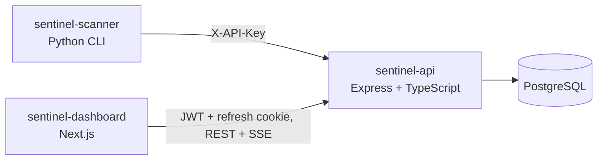

# sentinel-api

Backend for **Sentinel**, a self-hostable security monitoring platform. It ingests security events and scan results,
raises alerts from threshold rules, and streams them live to the dashboard.

> Status: **step 1 of 5** (scaffold). Auth, ingestion, the rules engine and incidents are added in the next steps.
> The full design is in [docs/PLAN.md](docs/PLAN.md).

Part of the Sentinel suite: [sentinel-api](https://github.com/MundatiC/sentinel-api) ·
[sentinel-dashboard](https://github.com/MundatiC/sentinel-dashboard) · [sentinel-scanner](https://github.com/MundatiC/sentinel-scanner)

## Architecture



## Quick start

Requires Node.js 22+.

```bash
cp .env.example .env
npm install
npm run dev          # http://localhost:4000/api/v1/health
```

With Docker (API + PostgreSQL):

```bash
cp .env.example .env
docker compose up --build
```

## Scripts

| Command             | What it does                |
| ------------------- | --------------------------- |
| `npm run dev`       | Start with auto-reload      |
| `npm test`          | Run Vitest + supertest      |
| `npm run lint`      | ESLint                      |
| `npm run typecheck` | TypeScript without emitting |
| `npm run build`     | Compile to `dist/`          |

## Security decisions so far

- Config is validated at startup (zod); the process refuses to start if it is invalid.
- `helmet` with a strict JSON-API CSP (`default-src 'none'`), no `X-Powered-By`.
- CORS allowlist with credentials; a wildcard origin is rejected at startup.
- 100 kb JSON body limit; one error shape; no stack traces or internals in responses.
- Request ids are validated before use, so clients cannot inject into logs; secrets are redacted from logs.
- Docker image runs as a non-root user; secrets come from the environment and are never committed.

## Screenshots

_Added once the dashboard is built._
