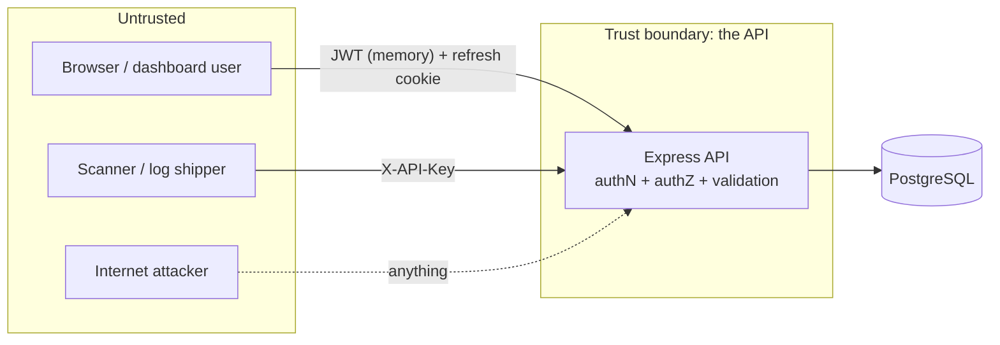

# Threat Model: sentinel-api

A short, honest threat model: what we protect, who might attack it, how, and what we do about it.
It also records the risks we **accept** and the limits of the current design.

## 1. What the system does

Sentinel ingests security events and scan results from machines (API keys), raises alerts from threshold rules,
and shows them to humans (JWT) in a dashboard, with a live feed.

## 2. Assets (what we are protecting)

| Asset                              | Why it matters                                            |
| ---------------------------------- | --------------------------------------------------------- |
| User credentials and sessions      | Account takeover gives access to all security data        |
| API keys                           | A stolen key lets someone inject fake events/alerts       |
| Event, scan and incident data      | Reveals weaknesses in the monitored systems               |
| Audit log                          | Evidence of who did what; must not be editable            |
| Alert integrity                    | A silenced or forged alert defeats the product's purpose  |
| Availability of the alert pipeline | An attacker may try to blind the monitor before attacking |

## 3. Actors and entry points

| Actor                               | Entry point                                | Capability assumed                                |
| ----------------------------------- | ------------------------------------------ | ------------------------------------------------- |
| Anonymous attacker                  | `/auth/*`, `/ingest/*` (guessing), `/docs` | Can send any HTTP request                         |
| Malicious or curious viewer/analyst | Authenticated endpoints                    | Valid account, lower role than the data they want |
| Stolen-credentials attacker         | Refresh cookie / access token / API key    | Has one credential                                |
| Compromised monitored system        | `/ingest/*` with a legitimate key          | Can send well-formed but false data               |
| Malicious data in events            | Event text shown to humans                 | Controls strings (log lines, usernames, URLs)     |

## 4. Threats and mitigations (STRIDE)

| #                          | Threat                                                             | Mitigation in this repo                                                                                                                        | Tests                                         |
| -------------------------- | ------------------------------------------------------------------ | ---------------------------------------------------------------------------------------------------------------------------------------------- | --------------------------------------------- |
| **Spoofing**               |                                                                    |                                                                                                                                                |                                               |
| S1                         | Guess passwords                                                    | argon2id; per-IP+email and per-account (all IPs, failures only) login limits; generic error; failed logins raise the brute-force alert         | `auth.test`, `engine.test`                    |
| S2                         | Learn which emails exist (timing/message)                          | Same message for every failure; dummy hash for unknown emails                                                                                  | `auth.test`                                   |
| S3                         | Forge a JWT (wrong secret, `alg: none`, expired)                   | HS256 pinned, issuer checked, 32+ char secret enforced                                                                                         | `auth.test`                                   |
| S4                         | Steal and replay a refresh token                                   | httpOnly cookie, stored hashed, rotation, reuse revokes the whole family                                                                       | `auth.test`                                   |
| S5                         | Guess or reuse an API key                                          | 256-bit secret, SHA-256 hash, constant-time compare, per-IP limit before auth, revocation/expiry                                               | `ingest.test`, `apiKeys.test`                 |
| **Tampering**              |                                                                    |                                                                                                                                                |                                               |
| T1                         | SQL injection through filters/search                               | Prisma parameterization; zod validation; `LIKE` wildcards escaped; raw SQL uses bound parameters                                               | `events.test`                                 |
| T2                         | Mass assignment (choose own role)                                  | Strict zod schemas reject unknown fields; register always creates a VIEWER                                                                     | `auth.test`, `users.test`                     |
| T3                         | Edit or delete audit history                                       | DB trigger rejects UPDATE/DELETE; no API for it                                                                                                | `database.test`                               |
| T4                         | Duplicate/forged alerts via races                                  | Partial unique index (one open alert per rule+key); atomic refresh-token claim                                                                 | `engine.test`, `database.test`                |
| **Repudiation**            |                                                                    |                                                                                                                                                |                                               |
| R1                         | "I never changed that role/rule/key"                               | Audit entry (actor, target, IP, user agent) for every privileged action; passwords/keys never logged                                           | `users.test`, `apiKeys.test`                  |
| **Information disclosure** |                                                                    |                                                                                                                                                |                                               |
| I1                         | Password hashes / key hashes in responses                          | Explicit field selection; tests assert absence                                                                                                 | `users.test`, `apiKeys.test`                  |
| I2                         | Secrets in logs                                                    | pino redaction for auth headers, cookies, API keys, passwords                                                                                  | code review                                   |
| I3                         | Stack traces and internals in errors                               | Central handler returns a generic 500                                                                                                          | `app.test`                                    |
| I4                         | Horizontal reads by lower roles                                    | `requireRole` on every router; admin-only routers apply it once at the top                                                                     | `users.test`, `alerts.test`, `audit.test`     |
| I5                         | XSS via stored event text                                          | API only returns JSON with `nosniff` and CSP `default-src 'none'`. **The dashboard must render all event fields as text** (see Residual risks) | `incidents.test`                              |
| **Denial of service**      |                                                                    |                                                                                                                                                |                                               |
| D1                         | Flooding ingest to blind the monitor                               | Per-IP and per-key rate limits; 1 MB body cap parsed only after authentication; max 500 events per batch                                       | `ingest.test`                                 |
| D2                         | Many open SSE connections                                          | Cap per user and in total; closed on token expiry or deactivation                                                                              | `sse.test`                                    |
| D3                         | Expensive queries                                                  | Page size ≤ 100; stats range ≤ 90 days; windows capped at 1000 events                                                                          | `events.test`                                 |
| D4                         | Huge passwords burning CPU in argon2                               | Max 128 characters                                                                                                                             | `auth.test`                                   |
| **Elevation of privilege** |                                                                    |                                                                                                                                                |                                               |
| E1                         | Viewer calls analyst/admin endpoints                               | Role middleware, deny by default                                                                                                               | `alerts.test`, `rules.test`, `incidents.test` |
| E2                         | Admin demotes/locks themselves out, or a demoted user keeps access | Self-change blocked; user + role loaded from DB on every request; deactivation revokes sessions                                                | `users.test`                                  |
| E3                         | API key used as a user, or with too much power                     | Keys cannot call user routes; scopes checked; `incidents:read` only unlocks one export route                                                   | `ingest.test`, `incidents.test`               |
| E4                         | CSRF on cookie-based endpoints                                     | `SameSite=Strict` cookie scoped to `/api/v1/auth`; state-changing routes use a Bearer header that browsers never attach automatically          | `auth.test`                                   |

## 5. OWASP Top 10 (2025) mapping

| OWASP 2025                                     | How Sentinel addresses it                                                                                                                                                | Where                                                           |
| ---------------------------------------------- | ------------------------------------------------------------------------------------------------------------------------------------------------------------------------ | --------------------------------------------------------------- |
| **A01 Broken Access Control**                  | Deny-by-default RBAC (`requireRole`), scoped API keys, UUID ids, no self-promotion, instant effect of role changes                                                       | `middleware/requireRole.ts`, `authenticate.ts`, `apiKeyAuth.ts` |
| **A02 Security Misconfiguration**              | helmet with strict CSP, CORS allowlist (no `*`), `X-Powered-By` off, env validated at startup, docs off in production, non-root container                                | `app.ts`, `config/env.ts`, `Dockerfile`                         |
| **A03 Software Supply Chain Failures**         | Lockfile + `npm ci`, `npm audit` in CI, Dependabot (npm, Docker, Actions), Swagger UI served locally instead of from a CDN, minimal runtime image                        | `.github/`, `docs.routes.ts`                                    |
| **A04 Cryptographic Failures**                 | argon2id, SHA-256 for high-entropy tokens, 256-bit random secrets, HS256 secret length enforced, secure cookies in production                                            | `lib/password.ts`, `lib/crypto.ts`, `lib/jwt.ts`                |
| **A05 Injection**                              | zod validation on every input, Prisma parameterized queries, bound parameters in the one raw query, LIKE escaping, JSON-only responses                                   | `middleware/validate.ts`, `events.routes.ts`                    |
| **A06 Insecure Design**                        | Registration off by default and viewer-only, refresh-token theft detection, DB-enforced alert dedup, scopes designed per use case, rule deletion blocked to keep history | `auth.service.ts`, migrations, `rules.routes.ts`                |
| **A07 Authentication Failures**                | Login rate limit per IP+email and per account, generic errors, short-lived access tokens, rotation, logout revokes the session, deactivation ends sessions               | `auth.*`, `rateLimiters.ts`                                     |
| **A08 Software or Data Integrity Failures**    | Strict schemas, body size caps, append-only audit log, all-or-nothing batch/scan writes (transactions), CI runs lint + tests + build before merge                        | `ingest.*`, `database.test.ts`                                  |
| **A09 Security Logging and Alerting Failures** | Audit log for privileged actions; structured logs with request ids and redaction; **Sentinel alerts on its own brute-force attempts**                                    | `audit.service.ts`, `pipeline.ts`, `logger.ts`                  |
| **A10 Mishandling of Exceptional Conditions**  | Central error handler; fail closed on auth errors; rule-evaluation failures logged without losing ingested data; graceful shutdown; readiness probe                      | `errorHandler.ts`, `pipeline.ts`, `server.ts`                   |

## 6. Residual risks and known limitations

These are deliberate trade-offs for a single-instance, portfolio-scale system. Each has a clear next step.

| Risk                                                                                                                                                          | Why we accept it                                                                                                                             | If it mattered more                                                                                                   |
| ------------------------------------------------------------------------------------------------------------------------------------------------------------- | -------------------------------------------------------------------------------------------------------------------------------------------- | --------------------------------------------------------------------------------------------------------------------- |
| **Dashboard XSS from stored event text.** The API stores hostile strings verbatim by design (they are evidence).                                              | The API cannot know where text will be rendered                                                                                              | Dashboard renders everything as text, no `dangerouslySetInnerHTML`, strict CSP (the dashboard repo must enforce this) |
| **A compromised API key can inject false events/alerts.**                                                                                                     | Machine keys must be able to write                                                                                                           | Per-key rate limits already bound the impact; add anomaly alerts per key, shorter key lifetimes                       |
| **In-memory rate limiting and live-feed bus** work only with one API instance.                                                                                | Keeps the project simple and explainable                                                                                                     | Redis store for limits; Postgres `LISTEN/NOTIFY` or Redis pub/sub for the bus; queue (BullMQ) for rule evaluation     |
| **Access tokens cannot be revoked individually** (valid up to 15 minutes).                                                                                    | The user is re-checked per request, so deactivation/role changes are immediate; only a stolen token for a still-active user lives on         | Token deny-list or shorter lifetime                                                                                   |
| **No MFA.**                                                                                                                                                   | Out of scope for this version                                                                                                                | TOTP for admins                                                                                                       |
| **Email enumeration via register (409).**                                                                                                                     | Registration is disabled by default                                                                                                          | Uniform response plus email verification                                                                              |
| **Audit log protected by an app-level trigger**, so a database superuser can still alter it.                                                                  | The API's DB role should not be a superuser                                                                                                  | Revoke privileges (see SECURITY.md) and ship the log to write-once storage                                            |
| **Failed-login events store the attempted email** (it can reveal a user mistyping a password into the username box).                                          | Needed to investigate attacks                                                                                                                | Hash or truncate; retention policy                                                                                    |
| **Single tenant:** every viewer can see all events and alerts.                                                                                                | Matches the self-hosted, one-team use case                                                                                                   | Add an organization id to every table and filter by it                                                                |
| **The per-account login limit can be used to annoy the owner:** 30 bad guesses from unfamiliar IPs block further attempts from unfamiliar IPs for the window. | Owners still get in from an IP that already logged in successfully (last 30 days, read from the audit log); nobody is locked out permanently | Exponential delay or a CAPTCHA after a few failures; an unlock by email or reset flow                                 |
| **`TRUST_PROXY` misconfiguration** lets clients spoof their IP (weakening rate limits and IP-grouped rules).                                                  | Cannot be detected from inside the app                                                                                                       | Documented in the hardening checklist                                                                                 |
| **No automated SAST/DAST** in CI yet.                                                                                                                         | Time/budget                                                                                                                                  | Add CodeQL and OWASP ZAP baseline scan                                                                                |

## 7. Security testing performed

- 175+ automated tests, including: forged / unsigned / expired JWTs, refresh-token theft and races, concurrent alert creation, SQL-injection and wildcard strings,
  mass assignment, role boundary checks on every router, API-key scope/expiry/revocation, SSE limits and expiry, audit immutability.
- `npm audit` runs in CI on every push.
